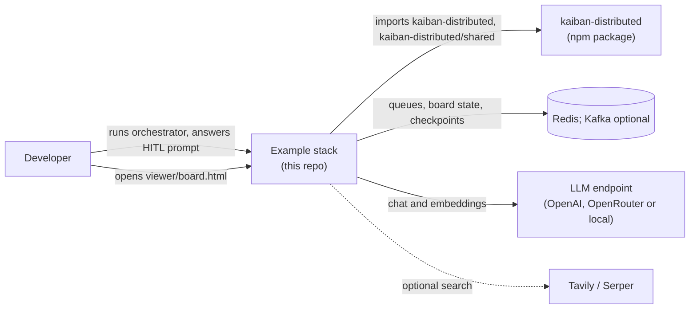
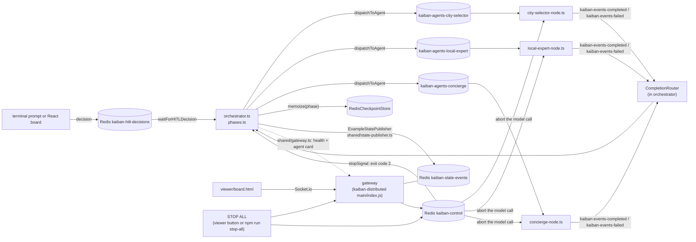
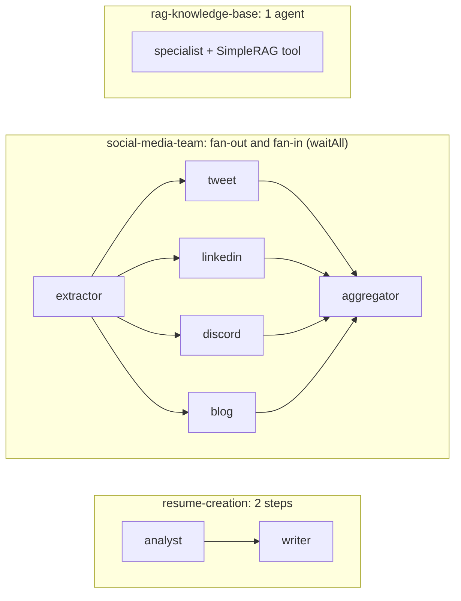

# Architecture

This repository holds example programs, not a framework. All runtime behaviour (the message
drivers, the gateway, the checkpoint store, the budget guard) comes from the published
[`kaiban-distributed`](https://github.com/andreibesleaga/kaiban-distributed) package. The code
here only configures agents and drives workflows. For per-platform deployment steps see
[`DEPLOYMENT.md`](../DEPLOYMENT.md).

## System context

## One example at a glance

Every example has the same four kinds of process, started from one Docker image
(`Dockerfile`). Names below are the files in `trip-planning/`; the other examples use the same
file roles, with the topologies shown after the "How to read it" list.

State, HITL and control channels are Redis pub/sub in both transports (Redis and Kafka); the
queues and completion events use the chosen transport. The STOP ALL arrows exist only with
`CONTROL_PLANE_ENABLED=true`; the viewer button goes through the gateway, `npm run stop-all` publishes
straight to `kaiban-control`.

How to read it:

- Each worker (`<role>-node.ts`) calls `startAgentNode` and consumes only its own queue,
  `kaiban-agents-<agentId>`.
- `phases.ts` holds one function per phase. A phase dispatches a task, waits on the
  `CompletionRouter`, then passes the result forward as context.
- `orchestrator.ts` wraps each phase in `orch.memoize(...)`. A restarted run with the same
  `WORKFLOW_ID` (default: a hash of the run inputs) skips phases already stored in Redis.
- The orchestrator keeps working if the gateway is down; only the board is lost
  (`shared/gateway.ts` is best-effort).
- Only trip-planning has the human-review channel. A stop ends its wait.

### The other topologies

The queues, checkpoints, board and STOP ALL paths are the same as above; only the phases differ.

In social-media-team the four composers run at once; `waitAll` tolerates a failed composer, and the
run fails only if all four fail. The orchestrator dispatches every step; the arrows show the order of the phases.

## Shared code

| File | Role |
|------|------|
| `shared/state-publisher.ts` | `ExampleStatePublisher`: publishes agent roster and task states to the board |
| `shared/run-logger.ts` | `RunLogger`: collects task results and totals, writes a transcript to `<example>/runs/` |
| `shared/gateway.ts` | `connectGateway`: best-effort health check, agent-card read and Socket.io echo. It sends no board token: with `BOARD_JWT_SECRET` set on the gateway the console echo is skipped; the run is unaffected |
| `shared/agent-card.ts` | `parseAgentCardSkills`: reads skills from an A2A agent card |
| `shared/ask.ts` | `ask`: terminal prompt that survives a closed stdin and ends on a stop |
| `shared/env.ts` | `envOr`, `firstEnv`, `envInt`: read optional variables; an empty compose value counts as unset |
| `shared/run-end.ts` | `endFailedRun`, `exitUnlessZero`: board status and exit code when a run stops or fails (0, 1, 2) |
| `shared/stop-signal.ts` | `openStopSignal`: the STOP ALL signal for an orchestrator, or `null` when the control plane is off |

Each example also has a `team-config.ts`; trip-planning and rag-knowledge-base add a `roster.ts` (the agents shown on the board, without building their tools).
