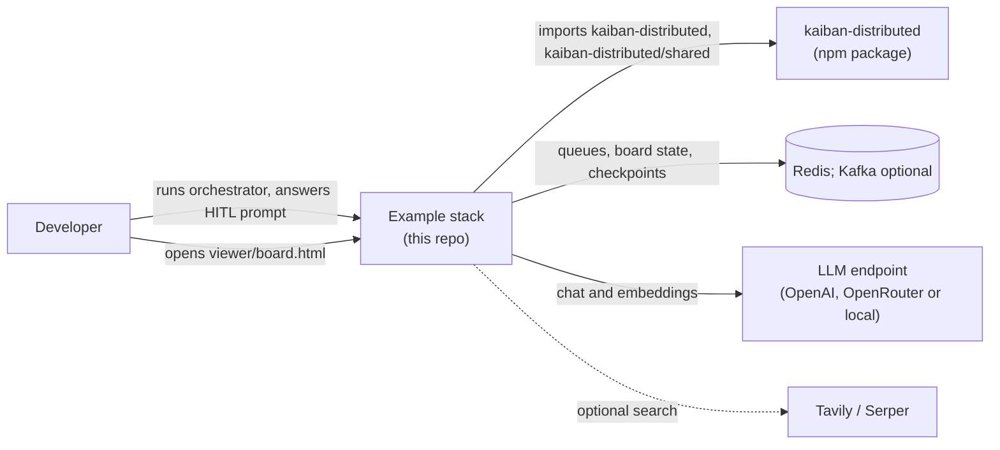
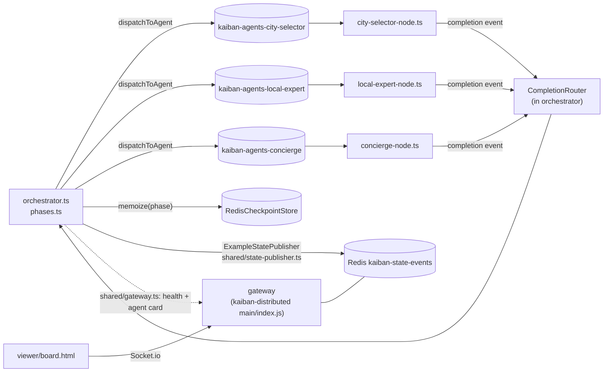

# Architecture

This repository holds example programs, not a framework. All runtime behaviour (the message
drivers, the gateway, the checkpoint store, the budget guard) comes from the published
[`kaiban-distributed`](https://github.com/andreibesleaga/kaiban-distributed) package. The code
here only configures agents and drives workflows. For per-platform deployment steps see
[`DEPLOYMENT.md`](../DEPLOYMENT.md).

## System context

## One example at a glance

Every example has the same four kinds of process, started from one Docker image
(`Dockerfile`). Names below are the files in `trip-planning/`; the other examples use the same
file roles.

How to read it:

- Each worker (`<role>-node.ts`) calls `startAgentNode` and consumes only its own queue,
  `kaiban-agents-<agentId>`.
- `phases.ts` holds one function per phase. A phase dispatches a task, waits on the
  `CompletionRouter`, then passes the result forward as context.
- `orchestrator.ts` wraps each phase in `orch.memoize(...)`. A restarted run with the same
  `WORKFLOW_ID` (default: a hash of the run inputs) skips phases already stored in Redis.
- The orchestrator keeps working if the gateway is down; only the board is lost
  (`shared/gateway.ts` is best-effort).

## Shared code

| File | Role |
|------|------|
| `shared/state-publisher.ts` | `ExampleStatePublisher`: publishes agent roster and task states to the board |
| `shared/run-logger.ts` | `RunLogger`: collects task results and totals, writes a transcript to `<example>/runs/` |
| `shared/gateway.ts` | `connectGateway`: best-effort health check, agent-card read and Socket.io echo |
| `shared/agent-card.ts` | `parseAgentCardSkills`: reads skills from an A2A agent card |
